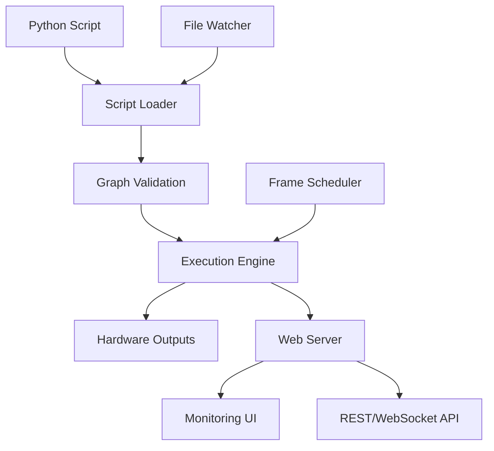

# RASL Architecture Overview

> **Note**: This document provides a high-level architectural overview. For detailed information on specific topics, see the [Documentation Index](README.md).

**RASL (Real-Time Animation Show Library)** is a standalone Python application for building and running real-time animation graphs targeting lights, motors, kinetic sculptures, and other channel-based systems.

## Core Philosophy

RASL enables users to compose **sources → transforms → sinks** into validated DAGs using Python scripts. The design prioritizes:
- **Correctness**: Typed contracts, deterministic timing, explicit behavior
- **Usability**: Hot-reload, built-in UI, intelligent defaults
- **Developer Experience**: Strong observability, minimal ceremony, composable primitives

## System Components



**Key Components**:
- **[Execution Engine](execution-engine.md)**: Scheduler, executor, validator, and monitor
- **[Script Integration](node-development.md)**: Safe script loading with hot-reload
- **[Web Interface](web-api.md)**: REST/WebSocket APIs and monitoring UI
- **[Plugin System](plugin-system.md)**: Extensible node library and format support

## Execution Model

**DAG-based Processing**: Nodes connect via typed ports to form validated graphs. The engine uses lazy, per-frame evaluation driven by sinks.

**Time Authority**: A pluggable scheduler produces frames `{t, dt, seq}` that provide consistent time reference for all nodes.

**Schema Validation**: Ports carry structured schemas (components + channels) ensuring type safety and unit consistency.

> **Detailed Information**: See [Execution Engine](execution-engine.md) and [Graph Model](graph.md)

## Key Concepts

### Node Types
- **Source**: Data generators (sine waves, file readers, network inputs)
- **Transform**: Data processors (math operations, filters, effects)
- **Sink**: Output handlers (hardware protocols, file writers, displays)

### Source Liveness
- **FINITE**: Bounded media with definite end (CSV file, audio file)
- **GENERATOR**: Can run indefinitely but may end naturally (sine wave, noise)
- **STREAMING**: External infinite streams (network input, live audio)

### Execution Modes
- **DETERMINISTIC**: Pure finite sources → predictable duration, export possible
- **CONTROLLABLE**: Finite + generator sources → user-controlled duration
- **LIVE**: Any streaming sources → real-time only

> **Detailed Information**: See [Time and Liveness](time-and-liveness.md)

## Graph Composition

**Instance-First Authoring**: Create node instances and wire their ports directly:
```python
sine = SineSource(freq=1.0, channels=150)
amp = ScaleBias(scale=0.8)
output = ConsoleSink()

# Wire the graph
sine.ports.out >> amp.ports.in >> output.ports.in
```

**Schema Validation**: Connections are validated for type compatibility, with automatic channel alignment by name.

> **Detailed Information**: See [Graph Model](graph.md)

## Performance Model

**Lazy Evaluation**: Nodes compute only when sinks demand their data, with per-frame memoization for efficiency.

**Frame Budgets**: Configurable timing constraints ensure real-time performance.

**Error Isolation**: Individual node failures don't crash the entire system.

> **Detailed Information**: See [Execution Engine](execution-engine.md)

## Validation and Safety

**Connection Validation**: Schema compatibility checked at connection time and engine start.

**Type Safety**: Ports carry structured schemas with units, ranges, and colorspace information.

**Error Handling**: Clear distinction between natural completion (EOS) and operational failures.

> **Detailed Information**: See [Graph Model](graph.md) and [Node Development](node-development.md)

## Web Interface

**REST API**: Graph inspection, parameter control, metrics collection

**WebSocket Streams**: Real-time metrics, events, and sample previews

**Monitoring UI**: Graph visualization, parameter control, performance monitoring

> **Detailed Information**: See [Web API](web-api.md)

## Node Development

**Base Class Architecture**: Centralized engine integration with mixin-based composable behaviors

**Separation of Concerns**: Base classes handle lifecycle, child classes focus on domain logic

**Execution State**: Read-only access to loop iteration, duration limits, downstream demand

> **Detailed Information**: See [Node Development](node-development.md)

## Extension Points

**Plugin System**: Extensible node library, file formats, and UI components

**Export System**: Offline rendering to various formats (fseq, CSV, JSON)

**Web API**: REST and WebSocket interfaces for custom integrations

> **Detailed Information**: See [Plugin System](plugin-system.md) and [Export System](export-system.md)

## Interoperability

**xLights Integration**: Export to FSEQ format for use with traditional lighting sequencers

**Format Support**: CSV for analysis, JSON for structured data, video for visualization

**Protocol Support**: sACN/E1.31, LIFX, and other lighting protocols via plugins

> **Detailed Information**: See [Export System](export-system.md)

## Design Conventions

**Explicit Over Magic**: Time conversions, looping, and error handling are visible and configurable

**Real-time First**: Frame budgets and performance monitoring ensure consistent timing

**Type Safety**: Structured schemas with units, ranges, and validation

**Graceful Degradation**: Missing plugins and node failures don't crash the system

## Quick Example

```python
from rasl import *

# Create nodes
sine = SineSource(freq=1.0, channels=150)
amp = ScaleBias(scale=0.8, bias=0.2)
output = ConsoleSink()

# Wire the graph
sine >> amp >> output

# Expose parameters for UI control
expose_parameter("sine.freq", min=0.1, max=10.0)
expose_parameter("amp.scale", min=0.0, max=2.0)
```

> **More Examples**: See [User Guide](user-guide.md) and the `examples/` directory

## Next Steps

- **[Getting Started](user-guide.md)**: Create your first RASL animation
- **[Documentation Index](README.md)**: Navigate to specific topics
- **[API Reference](api.md)**: Complete interface specifications

This overview provides the foundational concepts. Each linked document dives deep into specific aspects of the architecture and implementation.
