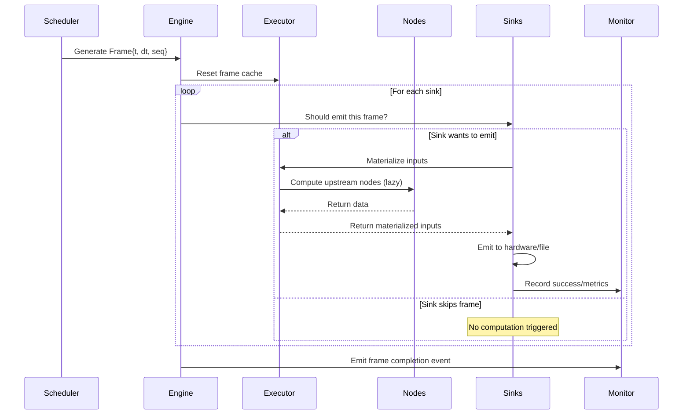

# Execution Engine Architecture

The RASL execution engine coordinates all components to run animation graphs in real-time. This document details the engine's internal architecture and component interactions.

## Engine Components

### Core Engine (`rasl.core.engine.Engine`)
The main coordinator that orchestrates all execution:

```python
class Engine:
    def __init__(self, 
                 sinks: Sequence[Sink],
                 scheduler: Scheduler,
                 executor: Optional[Executor] = None,
                 validator: Optional[Validator] = None,
                 monitor: Optional[NodeMonitor] = None):
        # Component initialization and graph validation
```

**Responsibilities**:
- Validate graph structure on startup
- Coordinate frame processing across all components
- Handle graceful shutdown and error recovery
- Provide execution mode detection
- Manage node lifecycle (creation, removal, cleanup)

### Scheduler (`rasl.core.scheduler`)
Generates frames at consistent intervals with configurable policies:

#### FixedRateScheduler
```python
scheduler = FixedRateScheduler(
    clock=MonotonicClock(),
    target_hz=60.0,
    cadence="drop"  # "drop" | "skip" | "slow"
)
```

**Cadence Recovery Policies**:
- `drop`: Skip frames to catch up when behind schedule
- `skip`: Continue at actual rate, don't try to catch up  
- `slow`: Run at achievable rate, don't maintain target timing

#### AdaptiveScheduler
Automatically adjusts frame rate based on system performance:

```python
scheduler = AdaptiveScheduler(
    clock=MonotonicClock(),
    target_hz=60.0,
    min_hz=10.0,
    load_threshold=0.8  # Reduce rate if CPU load > 80%
)
```

#### ManualScheduler
For testing and step-by-step execution:

```python
scheduler = ManualScheduler(clock=MonotonicClock())
scheduler.tick()  # Generate exactly one frame
```

### Executor (`rasl.core.executor.Executor`)
Handles lazy evaluation and per-frame memoization:

**Key Features**:
- **Lazy Evaluation**: Nodes compute only when sinks demand their data
- **Per-Frame Memoization**: Each node computes once per frame, cached by `(node_id, frame.seq)`
- **Shared Subgraph Optimization**: Common upstream branches compute once even with multiple consumers
- **Dependency Tracking**: Builds and maintains node dependency graph

```python
class Executor:
    async def materialize(self, port_ref: PortRef, frame: Frame) -> NDArrayLike:
        """Materialize data for a port, computing upstream nodes as needed."""
        
    def reset_frame_cache(self, frame: Frame) -> None:
        """Clear memoization cache for new frame."""
        
    def register_node(self, node: Node) -> None:
        """Register node for execution."""
```

### Validator (`rasl.core.validator.Validator`)
Ensures graph correctness before and during execution:

**Validation Phases**:

1. **Connection-Time Validation**:
   - Port existence and direction (`out → in`)
   - Schema compatibility (component/channel names)
   - Compute channel permutation maps

2. **Engine Start Validation**:
   - DAG structure (no cycles)
   - Duplicate node ID detection
   - Required inputs connected
   - Rate plan feasibility
   - Liveness/EOS policy completeness

3. **Runtime Validation** (optional):
   - Parameter value bounds checking
   - Schema contract enforcement
   - Performance constraint monitoring

```python
class Validator:
    def validate_connection(self, src_port: Port, dst_port: Port) -> ConnectionInfo:
        """Validate a single connection."""
        
    def validate_global(self, sinks: Sequence[Sink]) -> ValidationResult:
        """Validate entire graph structure."""
        
    def validate_runtime_constraints(self, node: Node, frame: Frame) -> None:
        """Check runtime constraints (optional)."""
```

### Monitor (`rasl.core.monitor.NodeMonitor`)
Tracks node health, performance, and system events:

**Monitoring Capabilities**:
- **Node Health**: Success/failure rates, error tracking
- **Performance Metrics**: Execution time, memory usage, frame processing rates
- **System Events**: Graph changes, EOS events, parameter updates
- **Alerting**: Configurable thresholds for performance degradation

```python
class NodeMonitor:
    def record_node_success(self, node_id: str, execution_time: float) -> None:
        """Record successful node execution."""
        
    def record_node_error(self, node_id: str, error: Exception) -> None:
        """Record node execution error."""
        
    def emit_event(self, event_type: str, **data) -> None:
        """Emit system event for observers."""
        
    def get_health_summary(self) -> HealthSummary:
        """Get overall system health status."""
```

## Execution Flow

### Frame Processing Cycle



### Lazy Evaluation Details

1. **Sink Decides**: Each sink independently decides whether to emit for this frame
2. **Demand Propagation**: If emitting, sink requests input data from executor
3. **Upstream Traversal**: Executor walks upstream, computing nodes on-demand
4. **Memoization**: Each node computes once per frame, result cached
5. **Shared Work**: Multiple sinks consuming same upstream node get cached result

### Error Isolation

**Per-Sink Isolation**: One sink failure doesn't stop others
```python
async def _process_frame(self, frame: Frame) -> None:
    for sink in self.sinks:
        try:
            await self._process_sink(sink, frame)
        except Exception as e:
            # Sink isolation - continue with other sinks
            logger.warning(f"Sink {sink.id} failed: {e}")
            self.monitor.record_node_error(sink.id, e)
```

**Node Removal**: Persistent failures remove nodes from graph
```python
if self._consecutive_errors >= self.max_frame_errors:
    logger.critical(f"Removing failed node {node.id}")
    self._remove_node_from_graph(node)
```

## Execution Modes

### Mode Detection
```python
def determine_execution_mode(self) -> ExecutionMode:
    source_liveness = {node.liveness for node in self.get_sources()}
    
    if Liveness.STREAMING in source_liveness:
        return ExecutionMode.LIVE
    elif Liveness.GENERATOR in source_liveness:
        return ExecutionMode.CONTROLLABLE
    else:
        return ExecutionMode.DETERMINISTIC
```

### Mode-Specific Behavior

**DETERMINISTIC Mode**:
- Calculate total duration from finite sources
- Enable export capabilities
- Support timeline scrubbing (future)
- Predictable resource usage

**CONTROLLABLE Mode**:
- User specifies execution duration
- Generator sources run until duration limit
- Export with duration policies
- Controlled resource usage

**LIVE Mode**:
- Infinite execution until stopped
- Real-time performance critical
- No export capabilities
- Dynamic resource management

## Performance Optimization

### Frame Budget Management
```python
class Engine:
    def __init__(self, frame_budget_ms: float = 16.0):  # ~60 FPS budget
        self.frame_budget = frame_budget_ms / 1000.0
        
    async def _process_frame_with_budget(self, frame: Frame) -> None:
        start_time = time.perf_counter()
        
        await self._process_frame(frame)
        
        elapsed = time.perf_counter() - start_time
        if elapsed > self.frame_budget:
            self.monitor.emit_event("frame_overrun", 
                                  frame=frame.seq, 
                                  elapsed=elapsed,
                                  budget=self.frame_budget)
```

### Memory Management
- **Per-Frame Cleanup**: Clear memoization cache after each frame
- **Resource Pooling**: Reuse data structures where possible
- **Garbage Collection Hints**: Explicit cleanup of large objects

### Concurrent Execution (Future)
- **Parallel Sinks**: Process independent sinks concurrently
- **Pipeline Stages**: Overlap frame generation with processing
- **Worker Threads**: Offload compute-heavy nodes to thread pool

## Configuration

### Engine Configuration
```python
@dataclass
class EngineConfig:
    # Performance
    frame_budget_ms: float = 16.0
    max_frame_errors: int = 10
    
    # Monitoring
    metrics_retention_seconds: float = 300.0
    health_check_interval: float = 1.0
    
    # Error Handling
    error_mode: Literal["strict", "graceful"] = "strict"
    remove_failed_nodes: bool = True
    
    # Optimization
    enable_memoization: bool = True
    enable_parallel_sinks: bool = False  # Future
```

### Runtime Tuning
```python
engine = Engine(sinks=sinks, scheduler=scheduler)

# Adjust performance parameters
engine.set_frame_budget(8.0)  # Tighter timing for high-performance rigs
engine.set_error_threshold(5)  # More aggressive node removal

# Monitor performance
stats = engine.get_performance_stats()
if stats.avg_frame_time > engine.frame_budget * 0.8:
    logger.warning("Approaching frame budget limit")
```

## Integration Points

### Script Loader Integration
```python
# Engine creation from loaded script
graph_spec = await script_loader.load_script("show.py")
engine = Engine.from_graph_spec(graph_spec, scheduler=scheduler)
```

### Web API Integration
```python
# Runtime parameter updates
await engine.update_node_parameter("sine_1", "freq", 2.0)

# Graph inspection
graph_info = engine.describe_graph()
node_status = engine.get_node_status("sine_1")
```

### Export System Integration
```python
# Offline rendering
if engine.execution_mode in (ExecutionMode.DETERMINISTIC, ExecutionMode.CONTROLLABLE):
    duration = engine.calculate_duration()
    await engine.render_offline(duration, output_format="fseq")
```

This architecture provides a robust, performant foundation for real-time animation graph execution while maintaining flexibility for different use cases and future enhancements.
