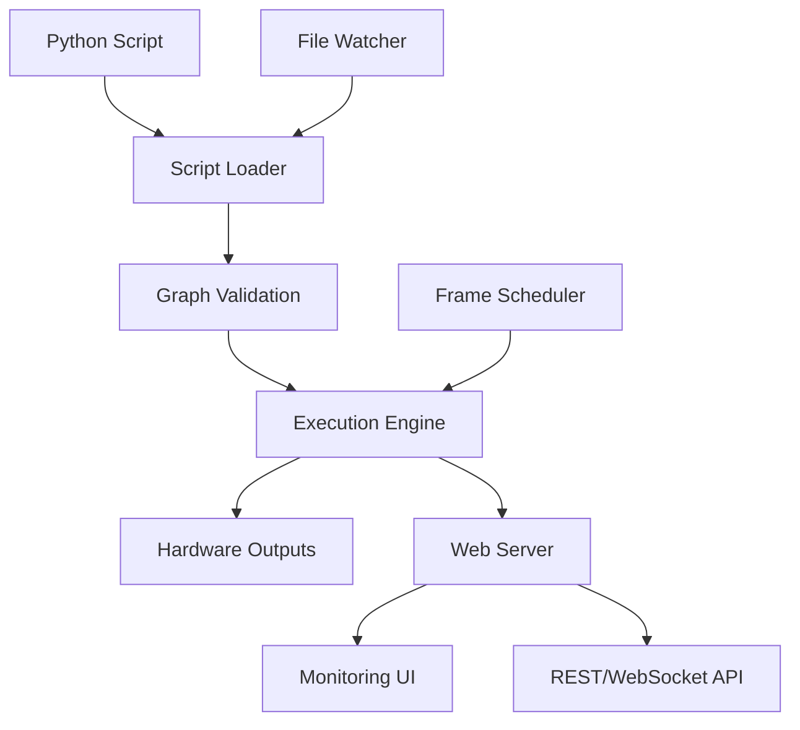

# RASL Overview

**RASL (Real-Time Animation Show Library)** is a standalone Python application for building and running real-time animation graphs targeting lights, motors, kinetic sculptures, and other channel-based systems.

## Core Philosophy

RASL enables users to compose **sources → transforms → sinks** into validated DAGs using Python scripts, then monitor and control them through a built-in web interface. The design prioritizes:

- **Correctness**: Typed contracts, deterministic timing, explicit behavior
- **Usability**: Hot-reload, built-in UI, intelligent defaults  
- **Developer Experience**: Strong observability, visual monitoring, minimal ceremony

## Key Differentiators

### vs. xLights
- **Real-time streaming** vs timeline sequences
- **Programmatic** vs visual authoring (with API depth for future visual tools)
- **Composable primitives** vs pre-built effects
- **Live parameter control** vs sequence playback

### vs. Traditional Programming
- **Graph-based** data flow with automatic validation
- **Built-in monitoring** and web interface
- **Hot-reload** without stopping output
- **Hardware abstraction** with protocol support

## Application Model

RASL operates as a **standalone executable** with integrated components:

## User Workflow

1. **Write Script**: Create Python script defining nodes and connections
2. **Launch Application**: `rasl run my_show.py` starts execution with web UI
3. **Monitor & Control**: Web interface provides real-time visualization and parameter control
4. **Live Editing**: Script changes trigger automatic graph updates without output interruption

## Execution Modes

RASL automatically detects execution mode based on source types:

- **DETERMINISTIC**: Pure finite sources → predictable duration, export possible
- **CONTROLLABLE**: Finite + generator sources → user-controlled duration, export possible
- **LIVE**: Any streaming sources → real-time only, no export

## Core Concepts

- **Frame**: `{t, dt, seq}` time reference emitted by scheduler
- **Node**: Source, Transform, or Sink with typed ports
- **Port**: Named I/O endpoint carrying structured data schemas
- **Schema**: Components + channels with units, ranges, colorspaces
- **Liveness**: Source capability (FINITE, GENERATOR, STREAMING)

## Next Steps

- **[Time and Liveness](time-and-liveness.md)**: Understanding execution modes and time handling
- **[Graph Model](graph.md)**: How nodes connect and data flows
- **[Node Development](node-development.md)**: Creating custom sources, transforms, and sinks
- **[Execution Engine](execution-engine.md)**: Scheduler, executor, and validation systems
- **[Web API](web-api.md)**: REST/WebSocket interfaces for monitoring and control
- **[User Guide](user-guide.md)**: Getting started with examples
- **[API Reference](api.md)**: Complete interface specifications
