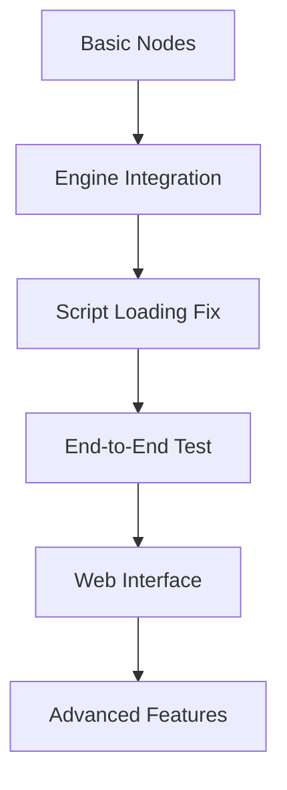

# RASL Implementation Priorities

## Immediate Next Steps (Week 1)

Based on the current codebase analysis, here are the critical tasks to get RASL working end-to-end:

### Priority 1: Complete Basic Node Implementations
**Status**: 🚧 Partially implemented  
**Effort**: 2-3 days

The existing node base classes need concrete implementations:

1. **SineSource** - Already has structure, needs `sample()` method completion
2. **ScaleBias** - Transform logic needs implementation  
3. **ConsoleSink** - Output formatting needs completion

### Priority 2: Engine Integration Testing
**Status**: ❌ Missing  
**Effort**: 1-2 days

Critical integration points:
- Engine → Scheduler → Executor workflow
- Script loader → Engine initialization
- Parameter updates during execution

### Priority 3: Fix Script Loading Integration
**Status**: 🚧 Partially working  
**Effort**: 1 day

Current gaps:
- Node discovery from script globals
- Connection registry integration
- Parameter exposure system

## Development Sequence

### Week 1: Foundation
- [ ] Complete basic node implementations (SineSource, ScaleBias, ConsoleSink)
- [ ] Fix script loading to work with existing examples
- [ ] Basic engine execution loop integration
- [ ] Get `rasl run examples/simple_sine.py` working

### Week 2: Core Functionality  
- [ ] Enhanced node library (NoiseSource, ColorSpaceTransform)
- [ ] Parameter system completion
- [ ] Web server basic endpoints
- [ ] Real-time parameter updates

### Week 3: Web Interface
- [ ] WebSocket implementation
- [ ] Basic web UI with graph visualization
- [ ] Parameter controls in browser
- [ ] Performance monitoring dashboard

### Week 4: Advanced Features
- [ ] Export system (FSEQ format)
- [ ] Plugin system foundation
- [ ] Performance optimization
- [ ] Documentation and examples

## Critical Path Dependencies

## Risk Assessment

### High Risk
1. **Engine Performance**: Real-time constraints are strict
   - *Mitigation*: Start with simple graphs, profile early
   
2. **WebSocket Stability**: Real-time updates can be fragile
   - *Mitigation*: Implement reconnection logic, graceful degradation

### Medium Risk
1. **Schema Validation Complexity**: Type system is sophisticated
   - *Mitigation*: Start with basic validation, iterate

2. **Hardware Protocol Integration**: sACN/LIFX may have compatibility issues
   - *Mitigation*: Test with real hardware early, provide fallbacks

### Low Risk
1. **Web UI Polish**: Functionality over aesthetics initially
2. **Export System**: Well-defined formats, clear requirements

## Success Metrics

### Week 1 Targets
- [ ] `examples/simple_sine.py` runs without errors
- [ ] Console output shows real-time sine wave data
- [ ] Parameter changes take effect immediately
- [ ] No memory leaks during 10-minute run

### Week 2 Targets  
- [ ] All example scripts run successfully
- [ ] Web server responds to basic API calls
- [ ] 60fps sustained execution for simple graphs
- [ ] Parameter updates via HTTP API work

### Week 3 Targets
- [ ] Web UI shows live graph visualization
- [ ] Parameter sliders update nodes in real-time
- [ ] WebSocket streams handle 60fps data
- [ ] Mobile-responsive interface

### Week 4 Targets
- [ ] FSEQ export works with xLights
- [ ] Plugin system loads external nodes
- [ ] Performance profiling shows bottlenecks
- [ ] Complete user documentation

## Quality Gates

Each week must pass these criteria before proceeding:

### Code Quality
- [ ] >80% test coverage for new code
- [ ] All tests pass in CI
- [ ] No critical security vulnerabilities
- [ ] Performance benchmarks met

### Integration Quality  
- [ ] All example scripts work
- [ ] No regression in existing functionality
- [ ] Error handling prevents crashes
- [ ] Memory usage within bounds

### User Experience
- [ ] Clear error messages for common mistakes
- [ ] Documentation updated for new features
- [ ] Examples demonstrate key capabilities
- [ ] Installation process works smoothly

## Resource Allocation

### Development Focus
- **60%** - Core engine and node implementation
- **25%** - Web interface and monitoring
- **10%** - Testing and quality assurance
- **5%** - Documentation and examples

### Testing Strategy
- **Unit Tests**: Every new node and core component
- **Integration Tests**: End-to-end workflows
- **Performance Tests**: Real-time execution benchmarks
- **Manual Testing**: Hardware protocol validation

This prioritization ensures we achieve a working end-to-end system quickly while building a solid foundation for advanced features.
