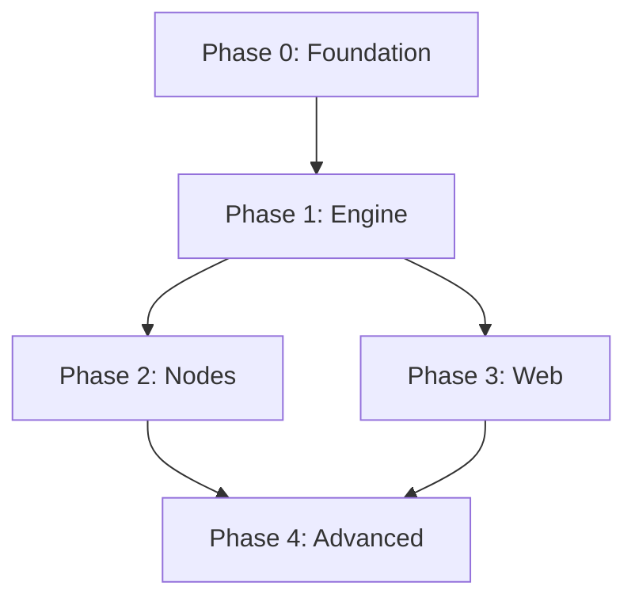

# RASL Integration Roadmap

## End-to-End Integration Strategy

The goal is to achieve a working end-to-end system as quickly as possible, then iteratively add features. This follows the principle of "make it work, then make it better."

## Critical Path to First Working System

### Milestone 1: Basic Script Execution (Week 1)
**Goal**: Run `examples/simple_sine.py` successfully with console output

**Required Components**:
1. ✅ Script loader (exists, needs integration testing)
2. 🚧 Engine execution loop (needs completion)
3. 🚧 Basic node implementations (SineSource, ScaleBias, ConsoleSink)
4. ✅ Connection system (exists)
5. ❌ Integration tests

**Success Criteria**:
- `rasl run examples/simple_sine.py` executes without errors
- Console shows sine wave data updating in real-time
- Script hot-reload works (change parameters, see updates)

### Milestone 2: Web Interface (Week 2)
**Goal**: Basic web monitoring interface

**Required Components**:
1. 🚧 Web server implementation (FastAPI structure exists)
2. ❌ REST API endpoints for graph inspection
3. ❌ Basic HTML monitoring page
4. ❌ WebSocket for real-time updates

**Success Criteria**:
- Web UI at `http://localhost:8080` shows running graph
- Real-time parameter updates visible in browser
- Basic graph visualization (nodes and connections)

### Milestone 3: Parameter Control (Week 3)
**Goal**: Live parameter adjustment via web interface

**Required Components**:
1. 🚧 Parameter exposure system (partially exists)
2. ❌ Web UI controls for exposed parameters
3. ❌ Real-time parameter updates via WebSocket
4. ❌ Parameter validation and bounds checking

**Success Criteria**:
- Adjust sine frequency via web slider, see immediate effect
- Parameter bounds enforced (min/max values)
- Changes reflected in both console output and web UI

## Integration Testing Strategy

### Test Pyramid Approach

```
    E2E Tests (Few, High Value)
         /\
        /  \
   Integration Tests (Some)
      /      \
     /        \
  Unit Tests (Many, Fast)
```

**Unit Tests (Foundation)**:
- Individual node behavior
- Type system validation
- Connection validation
- Parameter handling

**Integration Tests (Critical)**:
- Script loading and graph extraction
- Engine execution with real nodes
- Web API endpoints
- Parameter updates end-to-end

**E2E Tests (Validation)**:
- Complete user workflows
- Performance under load
- Error handling and recovery

### Test-First Development Flow

For each feature:
1. **Write failing integration test** - Define expected behavior
2. **Write minimal unit tests** - Test individual components
3. **Implement to pass tests** - Build just enough to make tests pass
4. **Refactor and optimize** - Improve code while keeping tests green

## Phase Dependencies



**Phase 0 (Foundation)** - Must complete first:
- Testing infrastructure
- Core type system validation
- Basic integration framework

**Phase 1 (Engine)** - Depends on Phase 0:
- Engine execution loop
- Basic scheduler implementation
- Error handling and recovery

**Phases 2 & 3 (Parallel)** - Can develop simultaneously:
- Node library expansion (Phase 2)
- Web interface implementation (Phase 3)

**Phase 4 (Advanced)** - Depends on 2 & 3:
- Export system
- Plugin architecture
- Performance optimization

## Risk Mitigation

### High-Risk Areas

1. **Engine Performance**: Real-time constraints require careful optimization
   - *Mitigation*: Performance tests from day 1, profiling tools
   
2. **Script Safety**: User code execution in controlled environment
   - *Mitigation*: Comprehensive validation, sandboxing tests
   
3. **Web Interface Complexity**: Real-time updates, parameter synchronization
   - *Mitigation*: Start simple, incremental complexity

### Validation Checkpoints

**Weekly Integration Tests**:
- All examples run successfully
- Performance benchmarks met
- Memory usage within bounds
- No resource leaks

**Milestone Reviews**:
- Architecture decisions documented
- Test coverage maintained >80%
- Documentation updated
- User feedback incorporated

## Success Metrics

### Technical Metrics
- **Test Coverage**: >80% for core components
- **Performance**: 60fps execution for typical graphs
- **Memory**: <100MB for basic examples
- **Startup Time**: <2 seconds for simple scripts

### User Experience Metrics
- **Time to First Success**: <5 minutes from installation
- **Learning Curve**: Basic example working in <30 minutes
- **Error Recovery**: Clear error messages, graceful degradation

### Development Metrics
- **Build Time**: <30 seconds for full test suite
- **Development Velocity**: New nodes implementable in <1 day
- **Debugging**: Full observability into execution state
